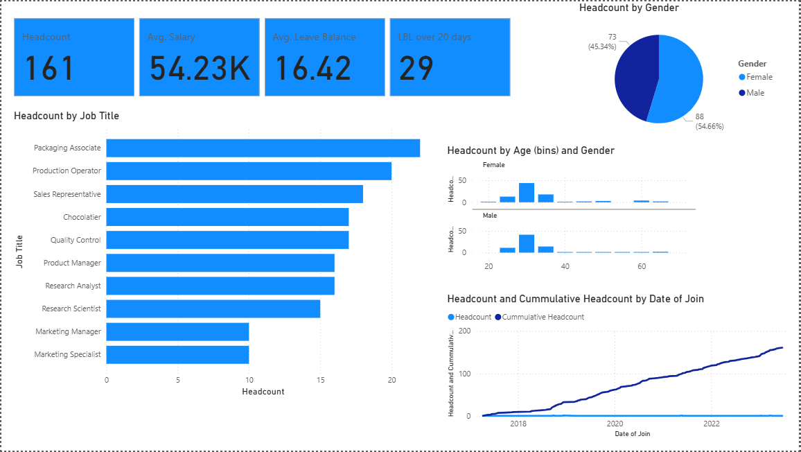

# HR Analytics Dashboard

An interactive Power BI report that analyzes workforce data, covering headcount, salary, leave balance, gender and age distribution, job roles, and hiring trends over time.

## Overview

This report gives HR teams a clear view of the workforce. It answers business questions across 10 report pages (Q1 to Q10), using KPI cards and visuals that can be filtered and explored.

## Key Metrics

- **Headcount:** 161 employees
- **Average Salary:** 54.23K
- **Average Leave Balance:** 16.42 days
- **Employees with leave balance over 20 days:** 29

## Visuals

| Visual | What it shows |
|---|---|
| **Headcount by Gender** (pie chart) | Split of the workforce between female and male employees |
| **Headcount by Job Title** (bar chart) | Number of employees in each role |
| **Headcount by Age (bins) and Gender** (column charts) | Age distribution of employees, split by gender |
| **Headcount and Cumulative Headcount by Date of Join** (line chart) | How the workforce has grown over time |

## Key Insights

- The workforce is about 55% female and 45% male.
- Packaging Associate and Production Operator are the largest job groups.
- Most employees are in their late 20s to 30s.
- Headcount has grown steadily from 2018 onward.
- 29 employees carry a leave balance of more than 20 days, which may be worth reviewing.

## Tools Used

- Power BI Desktop
- DAX
- Power Query

## Files in this Repository

- `HR_Analytics.pbix`: the Power BI report file
- `HR_Analytics_dashboard.png`: dashboard screenshot

## How to Use

1. Download `HR_Analytics.pbix`.
2. Open it in [Power BI Desktop](https://powerbi.microsoft.com/desktop/) (free).
3. Use the page tabs at the bottom to move between Q1 to Q10 and explore each analysis.
